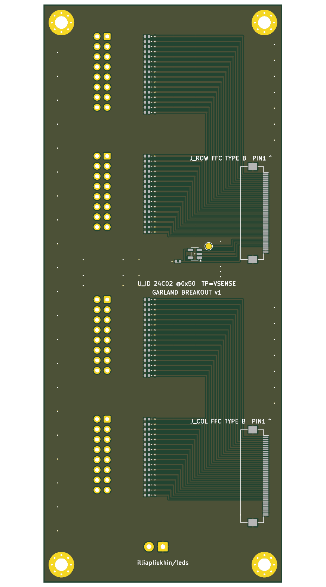

# Garland breakout v1

A passive fan-out between the mono electronics board's FFC pair and long wire runs (LED nets/garlands, remote panels). It follows [LED_INTERFACE_STANDARD.md](../common/LED_INTERFACE_STANDARD.md). To the cable it looks exactly like a panel: same FH12 footprint, cloned from `mono_panel_32x32` `J_ROW`, on B.Cu, cable exits west, pin 1 north, standard **Type B pin 1→1** FFC.

| | |
|---|---|
| Size | 60 × 145 mm, 2 layers, 1.6 mm, 1 oz, 4 × M3 plated (GND) |
| Inputs | `J_ROW`, `J_COL`: FH12-40S-0.5SH, both on the west edge (row cable above the column cable, so the two cables from `J_ROW1`/`J_COL1` run straight) |
| Outputs | `J_R1` rows 1–16, `J_R2` rows 17–32, `J_C1` cols 1–16, `J_C2` cols 17–32: 2×8 2.54 mm IDC box headers; **header pin n = line n = ribbon conductor n** |
| ESD | 64 × PESD5V0S1BL (bidirectional 5 V, SOD-882) from every line to GND, placed at the bus vias next to the headers |
| Row lines | 0.4 mm on the bus/F.Cu, 0.3 mm between header pins, 0.2 mm only in the 0.5 mm-pitch FFC escape (< 30 mm). Total breakout row resistance < 30 mΩ. |
| ID | `U_ID` 24LC02BT-I/OT at 0x50 on J_ROW 35/36/37, 100 nF, WP = GND; J_ROW 33/38/39/40 = GND (`ID_PRESENT_N` asserted) |
| Sense | `TP_VSENSE`: J_ROW pin 34 brought to a test pad (panel-end VLED/row tap for diagnostics) |
| Injection | `J_INJ` 3.5 mm 2-pole terminal, DNP: pin 1 GND (installation earth / ESD return), pin 2 `VINJ` (reserved for a future active row-repeater. A passive matrix cannot use remote VLED, see the standard §5) |
| J_COL spares | 33/38/40 GND; 34–37, 39 (`EXP_*`) left unconnected (reserved for column expansion) |

Assembly: all SMD on **B.Cu** (one reflow side). Only the IDC headers (and DNP J_INJ) are THT, on F.

Optional row-current sense was considered and left out of v1. Only one row is on at a time, so one shunt in the common `LED_4V1` feed on the main board measures the same thing more accurately than 32 series parts at 1.27 mm pitch. `TP_VSENSE` plus the EEPROM `row_path_mohm` field cover drop diagnostics.

## Files

| File | |
|---|---|
| `gen_garland_breakout.py` | parametric generator (KiCad 10 pcbnew, AppImage python3.11) |
| `make_fab.sh` | regenerate → DRC → renders → gerbers/drill/CPL → `fab/garland_breakout_fab.zip` |
| `garland_breakout.kicad_pcb` / `.kicad_pro` | board |
| `fab/drc_report.txt` | **0 violations, 0 unconnected** (KiCad 10, zones refilled) |
| `fab/garland_breakout_fab.zip` | Gerbers (Cu/mask/paste/silk/edge), Excellon, BOM, CPL |
| `fab/garland_breakout_bom.csv`, `fab/garland_breakout_cpl.csv` | |
| `img/garland_breakout_{top,bottom,iso}.png` | renders (no 3D models in the AppImage, so parts show as pads) |

## Price estimate (JLCPCB/LCSC class, Oct 2026, unverified, ±30 %)

| Item | 5 pcs | 50 pcs |
|---|---:|---:|
| PCB 60×145 2L HASL | ~$10 | ~$35 |
| SMT setup + stencil (one side) | ~$10 | ~$10 |
| Extended-part fees (FH12, PESD, 24LC02) | ~$9 | ~$9 |
| Parts per board: 2× FH12 ($1.8), 64× PESD5V0S1BL ($1.6), 4× IDC 2×8 box ($0.8), 24LC02 + C ($0.25) | ~$22 | ~$200 (~$4.0 ea) |
| Hand-solder 4 IDC headers (THT) | own time | ~$15 |
| **Total** | **≈ $50 (≈ $10/board)** | **≈ $270 (≈ $5.5/board)** |
| + 2 × Type B 40p 0.5 mm FFC 100–150 mm | ~$1/board | |
| + 4 × 16-way IDC sockets + 28 AWG ribbon 3 m | ~$3/board | |

## Bring-up checks

1. Continuity: J_ROW pin n ↔ J_R1/J_R2 pin n, J_COL pin n ↔ J_C1/J_C2 pin n (all 64). TVS to GND reads as a diode both ways (≈ 0.6–7 V on the diode tester; no shorts).
2. Without the main-board ID wiring (see LED_SCALING_OPTIONS.md, main-board changes), firmware falls back to the default profile. The LEDs still work.
3. Program `U_ID` with `firmware/panel_id/mkpanelid.py --preset garland32` (an external SOT-23 clip programmer works before the main board has the ID wiring).
