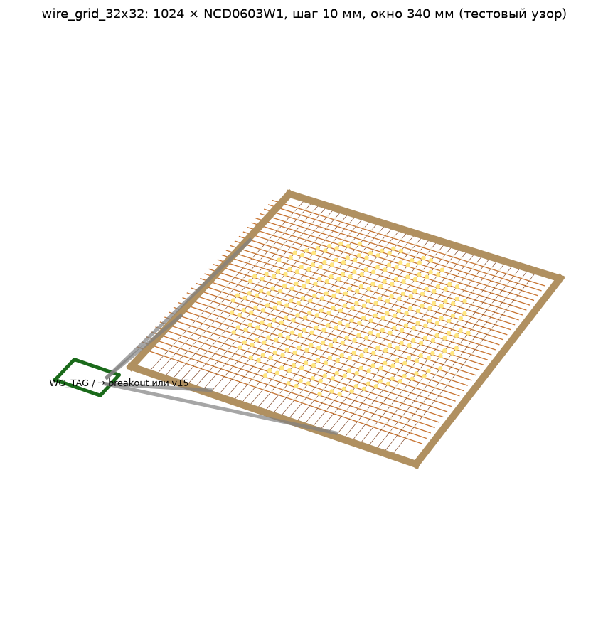
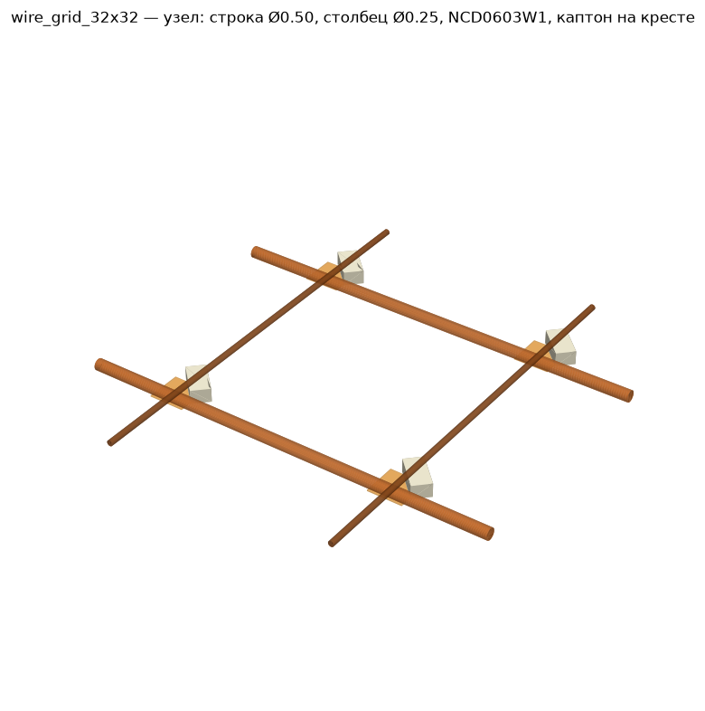

# wire_grid_32x32: 32×32 LEDs on wires (no PCB)

A cube-layer-style grid: 1024 × NCD0603W1 (0603 white) soldered between 0.50 mm enamelled row wires (anodes) and 0.25 mm enamelled column wires (cathodes), 10 mm pitch.
The wiring follows [LED_INTERFACE_STANDARD](../common/LED_INTERFACE_STANDARD.md). The grid connects through `garland_breakout` (option A) or through the WG_TAG tag board to v15 `J_RH1`/`J_CH1` (option B).
The build guide is in Russian: [BUILD.md](BUILD.md). All parameters are in `params.py`; run `./gen_all.sh` to regenerate.

Worst-case row drop at 0.32 A: **A 133 mV, B 81 mV** (limit 350 mV). Estimated cost **≈ $47 (A, without breakout) / ≈ $69 (B)**. EEPROM preset: `mkpanelid.py --preset wire32`.

## LED Vf bin (order note)

NCD0603W1 (C84265) is sold unbinned on LCSC/JLC (2.6–3.6 V @ 5 mA). The main board's 4.24 V rail allows ≤ 3.38 V at 10 mA, which is about ≤ 3.2 V @ 5 mA. **Order Vf bin 2.8–3.0 V @ 5 mA (preferred) or 3.0–3.2 V; reject > 3.2 V**, one bin per panel. The bin is printed as `VF(V)` on the reel label, and NationStar has no part-number suffix for it. With JLC either consign labelled reels or accept unbinned parts and screen at bring-up. Details: `hardware/common/LED_INTERFACE_STANDARD.md` §5.1.
